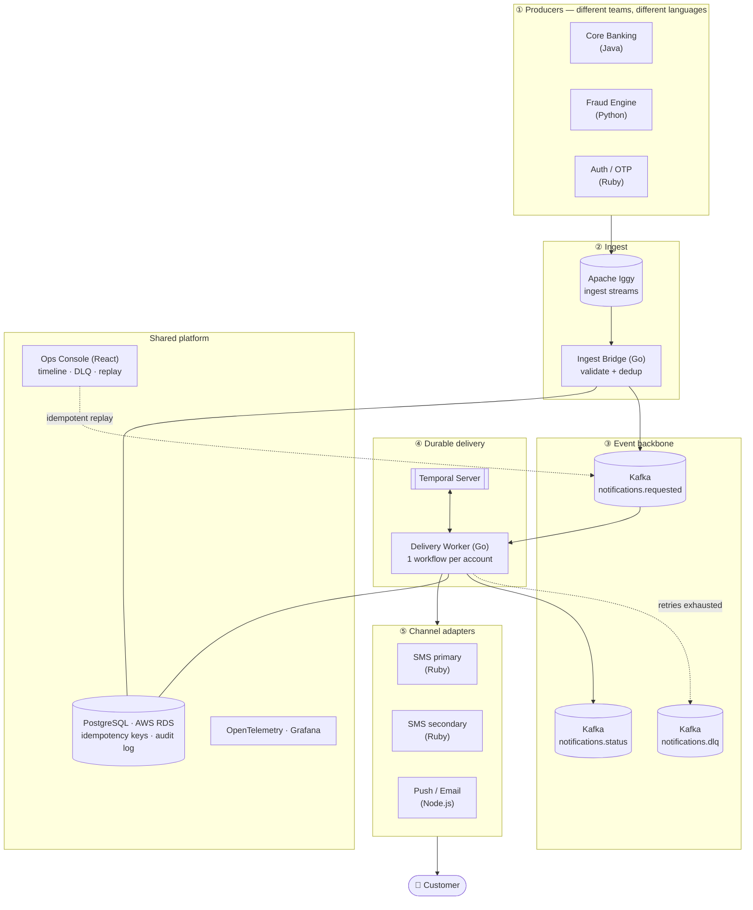
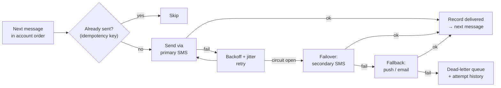
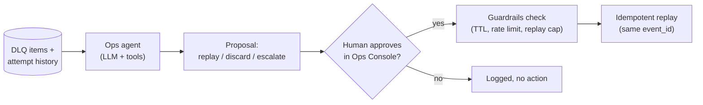

# RelayGuard: Reliable Messaging Service with Retry Semantics

**CMPE 273 · Enterprise Distributed Systems · Team Project · GroupProject 8**

---

## Title

**RelayGuard: An End-to-End Reliable, Ordered, Exactly-Once Alert Delivery Service for Polyglot Enterprise Systems**

---

## Abstract

Banks send customers time-critical messages: fraud alerts, deposit confirmations, one-time passcodes, low-balance warnings. Delivery crosses many systems owned by different teams in different languages. The core ledger emits an event, a fraud engine scores it, a notification service formats it, and an SMS provider delivers it. Any of these can fail. A provider can go down, a consumer can crash mid-send, or a cellular network can drop for minutes.

Naive retry makes things worse. Retries can send the same fraud alert three times, deliver "deposit confirmed" before "deposit pending," or quietly give up and drop the message. Customers then either ignore duplicate alerts or never see the one that mattered.

Existing tools each guarantee one hop. Kafka keeps the event durable, a worker retries a call, and an SMS provider retries to the handset. **RelayGuard guarantees the whole path, from transaction event to the customer's phone**, under crashes, retries, bursts and downstream outages. We prove it with measured failure tests.

RelayGuard provides:

- **Retries with backoff:** exponential backoff with jitter, a per-provider circuit breaker, and failover to a secondary provider or channel (SMS, then push, then email).
- **Dead-letter handling:** messages that never succeed go to a dead-letter queue with full failure history and can be replayed by an operator.
- **De-duplication:** one idempotency key from the source event to the provider call, so retries never deliver twice.
- **Per-customer ordering:** a customer's messages are delivered in the order the events occurred, while different customers proceed in parallel.
- **Crash-proof delivery:** each customer's delivery runs as a durable Temporal workflow that resumes exactly where it stopped after any crash.

### User Story

> **As a** mobile banking customer,
> **I want** my instant SMS fraud alerts and deposit confirmation notifications to be delivered reliably and in the exact order they occurred,
> **so that** even if the cellular network or SMS provider has an outage, the system automatically retries delivery without dropping my messages or spamming me with duplicate alerts when the network comes back online.

**Acceptance criteria**
1. No message is lost when the SMS provider, a consumer service or a broker is down. Messages are retried and delivered after recovery.
2. No customer receives the same alert twice, even when the same event is retried or replayed.
3. A customer's messages arrive in event order. A failing message for customer A does not block customer B.
4. After the maximum number of retries, a message goes to the dead-letter queue with its failure history, and an operator can replay it once.
5. Killing any service mid-delivery does not lose or repeat a send.
6. Every guarantee above is demonstrated by an automated failure test with measured results.

### What is novel

| Typical retry/queue project | RelayGuard |
|---|---|
| "We use Kafka, so it's reliable" | Guarantee defined **end to end** (event → phone) and proven per hop |
| Retries that can duplicate | One idempotency key carried from source event to provider call |
| Global ordering or none | **Per-customer ordering** with parallelism across customers (Temporal entity workflow per account) |
| Retry loop inside one process | Retries, timers and failover in a **durable workflow** that survives crashes |
| DLQ as a dead end | DLQ with failure history and **safe, idempotent replay** |
| Single-language app | **Polyglot producers and consumers** (Java, Python, Go, Ruby, TypeScript) through one contract, like a real bank |
| Demo shows the happy path | **Measured failure tests**: loss rate, duplicate rate, ordering violations, p99 latency under fault |

---

## Business Value

- **Customer trust and fraud loss.** A fraud alert that arrives late or gets lost means money is gone before the customer can react. Reliable, fast delivery directly reduces fraud losses.
- **No alert fatigue.** Duplicate or out-of-order alerts train customers to ignore them. Exactly-once, ordered delivery keeps alerts meaningful.
- **Lower cost.** SMS is billed per message. Deduplication stops paying for duplicate sends during retry storms.
- **Compliance and auditability.** Banks must show which notifications were sent and when. RelayGuard keeps a full delivery audit trail in Postgres, and dead-lettered messages are visible, not silently dropped.
- **Fits a real enterprise.** Each team keeps its own language and service. They publish to one contract, and RelayGuard owns delivery guarantees as a shared platform.
- **Reusable.** The same service applies to OTP codes, order updates, healthcare reminders and IoT alerts (for example, cold-chain temperature alerts).

---

## Proposed Architecture

### System overview

### Delivery workflow (per account)

### Reliability harness

The harness is part of the product, not an afterthought. It has three parts:

- **Load generator:** replays realistic banking traffic (deposits, fraud alerts, OTPs) at normal and burst rates.
- **Chaos injector (Toxiproxy + scripts):** kills services, partitions the network, adds latency and takes SMS providers down on a schedule.
- **Invariant checker (the "oracle"):** a fake phone that records every message it receives and checks the guarantees automatically:
  - **No loss:** every event sent was delivered or is in the DLQ.
  - **No duplicates:** each idempotency key was delivered at most once.
  - **Order:** per account, sequence numbers arrive increasing.
  - **Latency:** p99 stays under the target.

  Each test run ends with a pass/fail report plus numbers. This is what we show at the failure-testing review.

### Guardrails

Retries make delivery reliable, but they can also cause harm. These guardrails prevent that:

| Guardrail | What it prevents |
|---|---|
| **Priority lanes:** fraud alerts and OTPs ahead of everything else | A burst of low-priority messages delaying a fraud alert |
| **Message TTL:** an OTP expires after 5 min and is not delivered late | A stale code or outdated alert reaching the customer after it is useless |
| **Per-customer rate limit:** max N messages per minute | Spamming a customer during a retry storm or a buggy producer |
| **Retry budget:** cap on total retries per provider | Retry storms overwhelming a provider that is already struggling |
| **Circuit breaker:** stop calling a failing provider, then probe | Wasted retries and cascading failures |
| **Schema validation at ingest:** malformed events rejected up front | Poison messages clogging the pipeline |
| **PII masking in logs and traces** | Account numbers and phone numbers leaking into observability tools |
| **Kill switch per producer** (Ops Console) | One misbehaving team flooding customers |

Every guardrail has a matching failure test, for example "producer sends 500 alerts for one customer in 10 seconds, so the rate limit holds."

### How the end-to-end guarantee works, hop by hop

| Hop | Failure it must survive | Mechanism |
|---|---|---|
| Producer → Iggy | Producer retry, network blip | Producer-assigned `event_id` and per-account sequence number; at-least-once publish |
| Iggy → Kafka | Bridge crash, re-sends | Dedup on `event_id` (Postgres unique key); Kafka idempotent producer; key = `account_id` for ordering |
| Kafka → Delivery | Worker crash mid-send | Temporal workflow per account; `workflow_id = account_id`; message ID as activity idempotency key |
| Ordering | Message N fails while N+1 is ready | Account workflow delivers strictly in sequence; other accounts are unaffected |
| Delivery → Provider | Provider outage, timeouts | Exponential backoff with jitter, circuit breaker, failover to secondary provider, then push/email |
| Retries exhausted | Message can never succeed | Moved to DLQ with full attempt history; replay from Ops Console reuses the same idempotency key |
| Bursts | 10× event spike (fraud wave) | Iggy buffering, Kafka partitioning, Temporal task-queue rate limits per provider |

### Failure-testing plan (for the Nov 30 review)

| Test | Injected fault | Pass condition (measured) |
|---|---|---|
| T1 Consumer down | Stop SMS adapter for 5 min | Retries queued with backoff; all messages delivered after recovery; 0 lost |
| T2 Crash | `kill -9` delivery worker mid-send | Delivery resumes; 0 duplicates; 0 lost |
| T3 Replay | Re-publish the last 1,000 events | 0 duplicate sends |
| T4 Ordering | Fail message N for one account, then recover | N, N+1, N+2 arrive in order; other accounts unaffected |
| T5 Poison message | Message the provider always rejects | Lands in DLQ after max retries; replay delivers exactly once after fix |
| T6 Provider outage | Primary SMS provider down | Circuit opens; failover to secondary; report failover time |
| T7 Burst | 10× event rate for 2 min | No loss; report peak lag and recovery time |

Reported metrics: end-to-end latency (p50/p99, event → provider ack), loss rate, duplicate rate, ordering violations, recovery time.

---

## Proposed Technology

| Layer | Technology | Why |
|---|---|---|
| Ingest streaming | **Apache Iggy** | Lightweight, low-latency persistent streams for high-rate producer ingest |
| Event backbone | **Apache Kafka** | Durable, partitioned, ordered log shared across services |
| Durable workflows | **Temporal** | Crash-proof retries, timers, backoff, failover and per-account ordering |
| Database | **PostgreSQL on AWS RDS** | Idempotency keys, delivery log, DLQ metadata, audit trail |
| Ingest bridge, delivery worker | **Go** | Strong concurrency; official Iggy and Temporal Go SDKs |
| Core banking producer | **Java (Spring Boot)** | Typical bank core-system language |
| Fraud engine producer | **Python** | Scoring and data logic |
| Auth/OTP producer, SMS adapters | **Ruby** | Shows independent team ownership and cross-language contracts |
| Push/email adapter, Ops Console | **Node.js, TypeScript/React** | Delivery timeline, DLQ view and replay |
| Contracts | **Protobuf / JSON Schema** | One message contract across all languages |
| Observability | **OpenTelemetry, Prometheus, Grafana** | Trace one message across every service and language |
| Deployment | **Docker Compose** (local), **AWS** (demo) | Reproducible dev environment and live demo |
| Chaos testing | Custom harness plus **Toxiproxy** | Scripted crashes, partitions, latency and provider outages |

### Course module mapping

| Module | Where it shows up |
|---|---|
| 2 Communication | Polyglot services over Iggy/Kafka with Protobuf contracts |
| 3 Time & Ordering | Per-account sequence numbers and ordered delivery |
| 4 Replication & Consistency | Kafka replication; Postgres as the source of truth for dedup |
| 5 Distributed Transactions | Idempotency keys; Temporal saga for retry → failover → DLQ |
| 6 Fault Tolerance | Backoff, circuit breakers, failover, DLQ, chaos tests |
| 8 Event-Driven Systems | The entire pipeline |
| 9 Cloud-Native | Containerized services deployed on AWS |
| 10 Observability | OpenTelemetry tracing end to end |

---

## Team

**GroupProject 8**

| Name | Role |
|---|---|
| Y-Nha Nguyen | Team lead |
| Aaron Jiang | |
| Katherine Li | |
| Pooja Singh | |

**Repository:** https://github.com/SJSU-CMPE-273-Project/cmpe-273-project

---

## Addendum (updated November 2026)

This section adds the parts of the project that the course grades but the original proposal did not cover: design thinking, the agentic harness, security and OWASP, token economics, deployment, and how the team works. The original proposal above is unchanged.

### Graded Requirements Checklist

What the professor grades, and where each item is covered in this project:

| # | Requirement | How RelayGuard covers it | Section |
|---|---|---|---|
| 1 | Stanford d.school / IDEO design thinking: personas, empathy map, as-is vs. to-be | Four proxy personas (Maya, Jordan, Sam, Linda), Maya's empathy map, HMW questions, as-is vs. to-be, persona → feature → test traceability | [Design Thinking](#design-thinking-stanford-dschool--ideo) |
| 2 | Middleware | Apache Iggy (ingest), Kafka (event log), Temporal (durable workflows), one Protobuf contract | [Middleware](#middleware) |
| 3 | Agentic harness + prompts | DLQ ops agent: read-only tools, versioned prompts, human approval, guardrails | [Agentic Harness](#agentic-harness-dlq-ops-agent) |
| 4 | OWASP | OWASP Top 10 mapped to our controls, plus OWASP LLM risks for the agent | [Security and OWASP](#security-and-owasp) |
| 5 | Token economics | Tokens and cost per DLQ item, daily budget, cost-saving strategies | [Token Economics](#token-economics) |
| 6 | PostgreSQL | Idempotency keys, delivery audit log, DLQ metadata | [Proposed Technology](#proposed-technology) |
| 7 | Live one-node deploy, publicly accessible | Single-node deployment; only the Ops Console is public | [Deployment](#deployment) |
| 8 | Failure demo: consumer down → retries + DLQ → recovery | Tests T1 (consumer down) and T5 (poison message → DLQ → replay) | [Failure-testing plan](#failure-testing-plan-for-the-nov-30-review) |

### Design Thinking (Stanford d.school / IDEO)

We followed the five d.school stages before writing code.

> **Note:** we used **proxy personas** built from public banking-alert complaints and our own experience, not live interviews. The assumptions we still need to validate are listed at the end of this section.

#### 1. Empathize: who did we build this for?

| Persona | Role | Core pain |
|---|---|---|
| **Maya** (primary user) | Mobile banking customer | A late, duplicate or missing fraud alert costs her money or trust |
| Jordan | On-call platform engineer | Can't tell a lost message from a delayed one; afraid replay will double-send |
| Sam | Fraud-engine developer (Python) | Every team rewrites retry and dedup logic in its own language |
| Linda | Compliance analyst | No audit trail proving a customer was notified in time |

**Empathy map: Maya**

| Says | Thinks |
|---|---|
| "Why did I get the same fraud text three times?" · "The code expired before it arrived." | No text means nothing happened. Repeated alerts are probably spam. |
| **Does** | **Feels** |
| Replies YES/NO to fraud alerts. Starts ignoring alerts after repeats. Calls the bank when a code never comes. | Anxious when an alert is late, annoyed when it repeats, betrayed when it never comes. |

- **Pain:** a missing or late fraud alert means the money is gone before she can react.
- **Gain:** one alert per event, in order, fast enough to act on.

All four personas feel the same failure differently: the customer loses money or trust, the engineer loses sleep, the developer loses time, and the auditor loses proof.

#### 2. Define: problem statement and "How might we"

**Problem:** a bank alert crosses many teams, languages and providers, and no one guarantees the whole path. Customers get alerts late, twice, out of order or never, and no one can prove which.

- HMW deliver every alert exactly once and in order, even when a provider fails?
- HMW drop a stale one-time code instead of delivering it late?
- HMW let an engineer see and safely replay any failed message?
- HMW let producer teams publish once and stop writing their own retries?

#### 3. Ideate

We brainstormed options for each HMW question and ranked them on an impact/effort 2×2. Chosen: idempotency keys, per-account ordered workflows, a DLQ with safe replay, and the guardrails listed above.

#### 4. Prototype

- Ops Console mockup: message timeline, DLQ, replay, kill switch, agent suggestions
- Platform scaffold: Docker Compose stack, Protobuf contract, database schema

#### 5. Test

Failure tests T1–T7, checked automatically by the oracle. Each test maps back to a persona need (traceability table below).

#### As-is vs. to-be

| As-is | To-be (RelayGuard) |
|---|---|
| Each team writes its own retry logic | One shared contract; the platform owns delivery |
| Duplicates during retry storms | Exactly-once delivery through idempotency keys |
| Lost messages leave no trace | Every message is delivered or in the DLQ, with full history |
| Engineers grep five services to trace one message | One timeline per message in the Ops Console |
| Stale codes still get delivered | Expired messages are dropped by the TTL guardrail |

#### Persona → feature → test

| Need | Feature | Proven by |
|---|---|---|
| Maya: one alert, in order | Idempotency key + per-account workflow | T2, T3, T4 |
| Maya: no stale codes | Message TTL guardrail | T5 |
| Jordan: safe recovery | DLQ + idempotent replay | T1, T5, T6 |
| Sam: publish once | Shared Protobuf contract | Five-language demo |
| Linda: proof of delivery | Postgres audit log | Ops Console timeline |

#### Assumptions to validate

- [ ] Customers prefer a late alert over a duplicate (except OTPs, which are useless late)
- [ ] On-call engineers will trust automated replay if they can see it is idempotent
- [ ] Producer teams will accept one shared Protobuf contract
- [ ] Auditors need attempt-level history, not just the final state

### Middleware

RelayGuard is a message-oriented middleware layer between producer teams and delivery channels:

| Middleware role | Component |
|---|---|
| Ingest buffer for high-rate producers | Apache Iggy |
| Durable, partitioned event log | Apache Kafka |
| Durable workflow orchestration (retries, timers, saga) | Temporal |
| Shared message contract | Protobuf |

### Agentic Harness: DLQ Ops Agent

An LLM-based agent helps the on-call engineer (Jordan) triage the dead-letter queue. It **suggests**; a human **approves**; the platform **enforces**.

- **Tools (read-only by default):** read DLQ items, read attempt history, read provider and circuit-breaker status. The only write tool is `propose_action`; it does not replay anything itself.
- **Prompts:** system and task prompts are stored in `agent/prompts/` and versioned with the code. Each proposal records the prompt version that produced it.
- **Guardrails on the agent:** max replays per run, no replay of expired messages, rate limits still apply, PII masked before anything reaches the model, and every proposal requires human approval.
- **Evaluation:** a fixed set of DLQ scenarios (expired OTP, poison message, provider outage) with expected actions, run on every prompt change.

### Security and OWASP

| OWASP Top 10 (2021) risk | Where it applies | Control in RelayGuard |
|---|---|---|
| A01 Broken Access Control | Ops Console replay and kill switch | Role-based access; replay and kill switch limited to operators |
| A02 Cryptographic Failures | Service-to-service traffic, PII at rest | TLS in transit; phone and account numbers masked in logs |
| A03 Injection | Event payloads, Ops Console search | Schema validation at ingest; parameterized SQL only |
| A04 Insecure Design | Retry storms, duplicate sends | Idempotency keys, retry budget, rate limits, circuit breaker |
| A05 Security Misconfiguration | Public demo deployment | Only the Ops Console is exposed; Kafka, Postgres and Temporal stay private |
| A07 Identification and Authentication Failures | Producers publishing events | Signed service tokens per producer; kill switch per producer |
| A09 Security Logging and Monitoring Failures | Audit trail | Full delivery and attempt log in Postgres; OpenTelemetry traces |

**LLM-specific risks (OWASP Top 10 for LLM Applications):**

| Risk | Control |
|---|---|
| Prompt injection (message content tries to instruct the agent) | Message bodies are passed as data, never as instructions; the agent cannot act without human approval |
| Sensitive information disclosure | PII masked before it reaches the model |
| Excessive agency | Read-only tools; one `propose_action` tool; human approval; replay cap |

### Token Economics

The ops agent is the only part of RelayGuard that uses an LLM, so token cost scales with DLQ volume, not with total message volume.

| Item | Estimate (to be measured) |
|---|---|
| Tokens per DLQ item (input + output) | [__] |
| Cost per 1,000 DLQ items | [$__] |
| DLQ items per day at demo load | [__] |
| Cost per day | [$__] |

**Strategies to keep cost down:**
- Batch similar DLQ items (e.g. all items from one provider outage) into one request
- Use a small, cheap model for classification and a larger model only for unclear cases
- Send masked summaries of attempt history, not raw logs
- Cache results for repeated failure patterns
- Hard daily token budget; when it is reached, the agent stops and the DLQ is handled manually

### Deployment

- **Local development:** Docker Compose, the full stack on one machine
- **Live demo:** a single-node deployment on [AWS / chosen host], publicly accessible
- **Public surface:** only the Ops Console (and the demo trigger) has a public URL; all other services are internal
- **Cost:** free or low-cost tier where possible

### Course Module Mapping (additions)

| Module | Where it shows up |
|---|---|
| 11 Security | OWASP controls, service tokens, TLS, PII masking |
| 12 Agentic Systems | DLQ ops agent, versioned prompts, human-in-the-loop, token budget |

### How We Work

- **Process:** design thinking first, then work tracked in **Jira**, one epic per lane
- **Lanes:**
  1. Ingest and producers
  2. Delivery core
  3. Adapters and reliability harness
  4. Ops Console, platform and course extras
- **Shared work:** design thinking, token economics, review slides
- **Milestones:** Nov 4 contract frozen · Nov 11 happy path end to end · Nov 18 guardrails and failover · Nov 23 agent and security · Nov 30 failure-testing review · Dec 7 live demo
